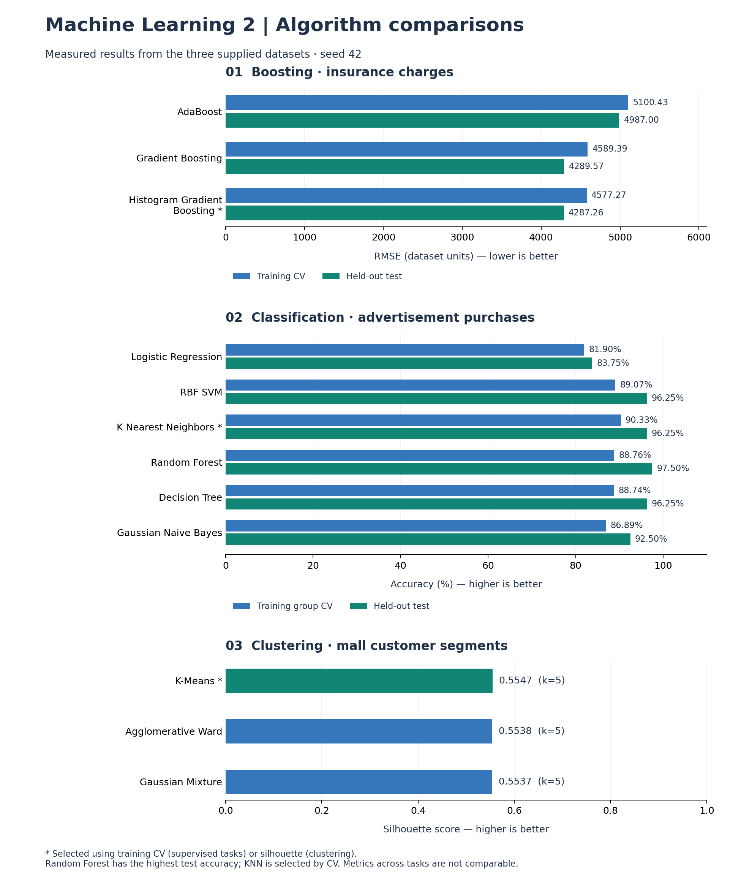
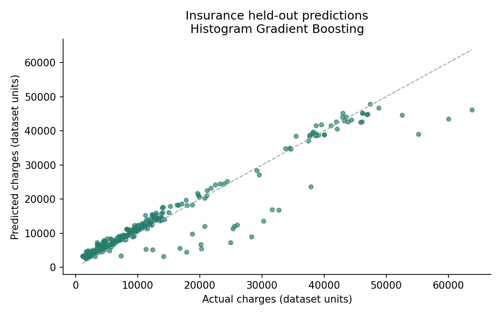
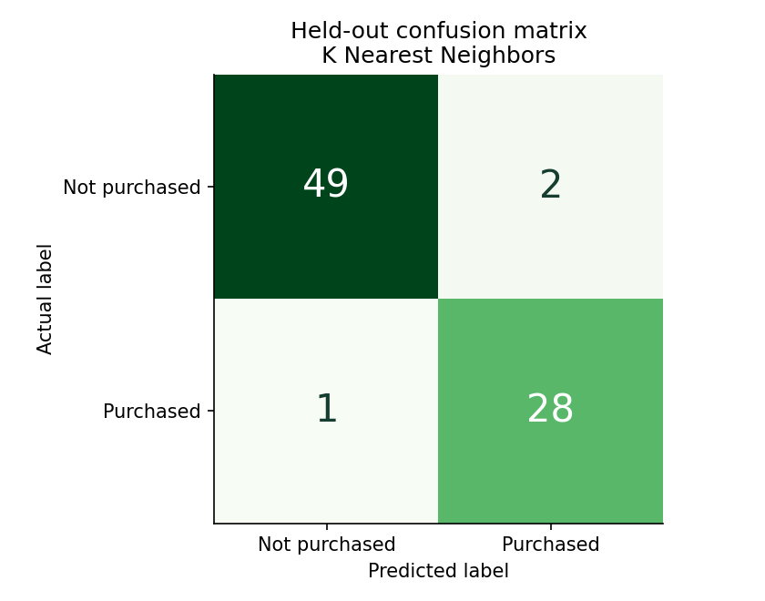
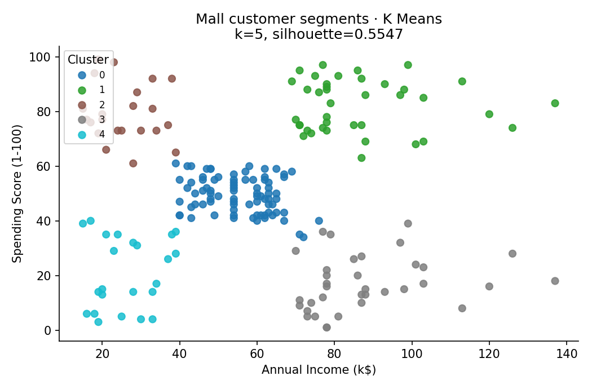

# Machine Learning Subject — Three-Dataset Algorithm Comparison

**Student:** Gowthami.M · **USN:** 1AM23CI042 · **Roll number:** 42

This is the **Machine Learning** assignment, separate from the **Cryptography and Network Security / Theme E: Network Traffic Analysis** assignment. Do not use network packet captures as one of the ML datasets.

The three original datasets were used for three different learning tasks. The experiment files, trained estimators, split records, saved predictions and charts are in [ml/results](results/). Re-run the training with `python ml/train_compare.py` from the repository root. All three newly uploaded CSVs match the SHA-256 fingerprints recorded in `ml/results/results.json`.

## 1. Boosting — insurance_pre.csv

**Target:** `charges` (continuous numeric value). Select the model with the **lowest 5-fold training CV RMSE**, then report held-out test metrics.

| Algorithm | CV RMSE ↓ | Test RMSE ↓ | Test R² ↑ |
|---|---:|---:|---:|
| AdaBoost | 5100.43 | 4987.00 | 0.8647 |
| Gradient Boosting | 4589.39 | 4289.57 | 0.8999 |
| Histogram Gradient Boosting | 4577.27 | 4287.26 | 0.9000 |

**Selected by training CV:** Histogram Gradient Boosting (CV RMSE 4577.27). This is a regression experiment, so RMSE and R² are appropriate—not classification accuracy.

## 2. Classification — Social_Network_Ads.csv

**Target:** `Purchased` (0 or 1). Select by **highest grouped 5-fold training CV accuracy**, then measure accuracy on the reserved test split. `User ID` is excluded; feature-identical records are grouped to limit leakage.

| Algorithm | CV accuracy ↑ | Test accuracy ↑ | Test F1 ↑ |
|---|---:|---:|---:|
| Logistic Regression | 81.90% | 83.75% | 0.7347 |
| RBF SVM | 89.07% | 96.25% | 0.9492 |
| K Nearest Neighbors | 90.33% | 96.25% | 0.9492 |
| Random Forest | 88.76% | 97.50% | 0.9667 |
| Decision Tree | 88.74% | 96.25% | 0.9508 |
| Gaussian Naive Bayes | 86.89% | 92.50% | 0.8929 |

**Selected by training CV:** K Nearest Neighbors (90.33% CV accuracy; 96.25% test accuracy). Random Forest's observed test accuracy is 97.50%, but choosing using the held-out test would compromise the test's role.

## 3. Clustering — Mall_Customers.csv

**Features:** `Annual Income (k$)` and `Spending Score (1-100)` (standardized); no target label. Select by **highest silhouette score**, searching cluster counts 2–8 for each algorithm.

| Algorithm | Best cluster count | Silhouette ↑ | Davies–Bouldin ↓ |
|---|---:|---:|---:|
| K Means | 5 | 0.5547 | 0.5722 |
| Agglomerative Ward | 5 | 0.5538 | 0.5779 |
| Gaussian Mixture | 5 | 0.5537 | 0.5760 |

**Selected:** K Means, k=5 (silhouette 0.5547). A silhouette score is **not accuracy**. Clustering labels have no ground-truth class here.


## Graphs and worked examples

These graphs use the saved experimental results, not illustrative or invented scores.



- **Boosting:** lower RMSE means smaller prediction errors. Histogram Gradient Boosting is selected by training CV and has test R² 0.9000.
- **Classification:** blue bars show training cross-validation accuracy; green bars show held-out test accuracy. KNN wins the CV comparison (90.33%); Random Forest has the highest observed test accuracy (97.50%). Model selection uses CV.
- **Clustering:** K-Means has the highest silhouette (0.5547), with five clusters. The algorithms are very close; this small difference does not establish general superiority. Silhouette is not classification accuracy.

### Example 1: Actual versus predicted insurance charges



Each dot represents one held-out record. Points near the dashed diagonal have predictions close to the actual charge. The vertical distance from that line shows prediction error. The 268 test records give an RMSE of 4287.26 in the dataset's units.

### Example 2: Classification confusion matrix



Rows are actual outcomes and columns are predicted outcomes. KNN correctly classifies 49 non-purchases and 28 purchases: **77/80 = 96.25% accuracy**. Two non-purchases are predicted as purchases, and one purchase is missed.

### Example 3: Customer clusters



Each dot is one customer; colors indicate K-Means cluster assignments. The graph illustrates groups such as high-income/high-spending and high-income/low-spending customers. These are exploratory descriptions, not known customer classes. Clustering used standardized income and spending, while the chart displays the original units.

### Regenerate the graphs

Run `python ml/train_compare.py` to recreate the three example charts and training outputs, then `python ml/plot_comparisons.py` to recreate the comparison overview from `results/results.json`. A [vector SVG](results/algorithm_comparisons.svg) is available for resizing in presentations.

## Submission checklist

- [x] All three supplied original CSV datasets
- [x] Multiple algorithms compared for each appropriate task
- [x] Evaluation and fair model-selection criteria
- [x] Results table for each algorithm
- [x] Reproducible Python source, prediction outputs, trained models, charts and training log
- [ ] Present results to faculty and verify any course-specific report requirements

**Important:** The three scores have different meanings and must not be ranked against one another. No cross-task “best overall algorithm” is statistically meaningful.


## Reproduction verification — 19 November 2026

Re-executed the repository's `ml/train_compare.py` using the three repository CSV datasets. The run completed successfully (exit code 0). All numeric values in the regression, classification and clustering result tables matched the previously committed results within `rtol=1e-10, atol=1e-10`. All 12 algorithm comparisons and all three selected model families were reproduced.

Environment: Python 3.12.14; scikit-learn 1.8.0; NumPy 2.3.5; pandas 2.2.3; matplotlib 3.10.8; joblib 1.5.3. Seed: 42. The script's split-disjointness, saved-score and model-reload assertions passed.

Reproduction command (from the repository root):

```sh
python -m pip install -r ml/requirements.txt
OPENBLAS_NUM_THREADS=1 OMP_NUM_THREADS=1 MKL_NUM_THREADS=1 python ml/train_compare.py
```

Dataset fingerprint clarification: the existing `results.json` records SHA-256 fingerprints of the original CRLF files. Git stores these CSV files with LF line endings, so raw byte fingerprints differ; converting the repository files back to CRLF reproduces all three original fingerprints. The data values are unchanged. Repository LF fingerprints are:

| Dataset | SHA-256 |
|---|---|
| insurance_pre.csv | `e6e380c6743eb3f9aa35f5815d49b971b2cdc5811ebc561f3fbee283a85ac743` |
| Mall_Customers.csv | `3b3501663511db1a3db41e6e8138b4f59e40217ec3b62fa3713b0563836aecfa` |
| Social_Network_Ads.csv | `64783cdaf0ca192b2fa54ae5a5a27aa201ba9156d8a0f67afc7cadd8b7784c89` |

Console output from the verification run:

```text
Regression: AdaBoost 4986.998349988725
Regression: Gradient Boosting 4289.573065285522
Regression: Histogram Gradient Boosting 4287.264250704026
Classification: Logistic Regression 0.8375
Classification: RBF SVM 0.9625
Classification: K Nearest Neighbors 0.9625
Classification: Random Forest 0.975
Classification: Decision Tree 0.9625
Classification: Gaussian Naive Bayes 0.925
Clustering: K Means {'algorithm': 'K Means', 'clusters': 5, 'silhouette': 0.5546571631111091, 'davies_bouldin': 0.5722356162263352, 'calinski_harabasz': 248.64932001536357}
Clustering: Agglomerative Ward {'algorithm': 'Agglomerative Ward', 'clusters': 5, 'silhouette': 0.5538089226688662, 'davies_bouldin': 0.5778621190740154, 'calinski_harabasz': 244.41032586596822}
Clustering: Gaussian Mixture {'algorithm': 'Gaussian Mixture', 'clusters': 5, 'silhouette': 0.5536892843811245, 'davies_bouldin': 0.5760100302410824, 'calinski_harabasz': 244.9401969858632}
SELECTED Histogram Gradient Boosting K Nearest Neighbors K Means
```

### Opening this submission

This repository was private at verification time. Open it while signed in as its owner, `vishalravi2k-amc`, or as an invited collaborator. A viewer without permission may see “Could not resolve to a Repository” or a 404 even when the URL is correct. Faculty access requires a collaborator invitation or an owner-approved change to public visibility.
