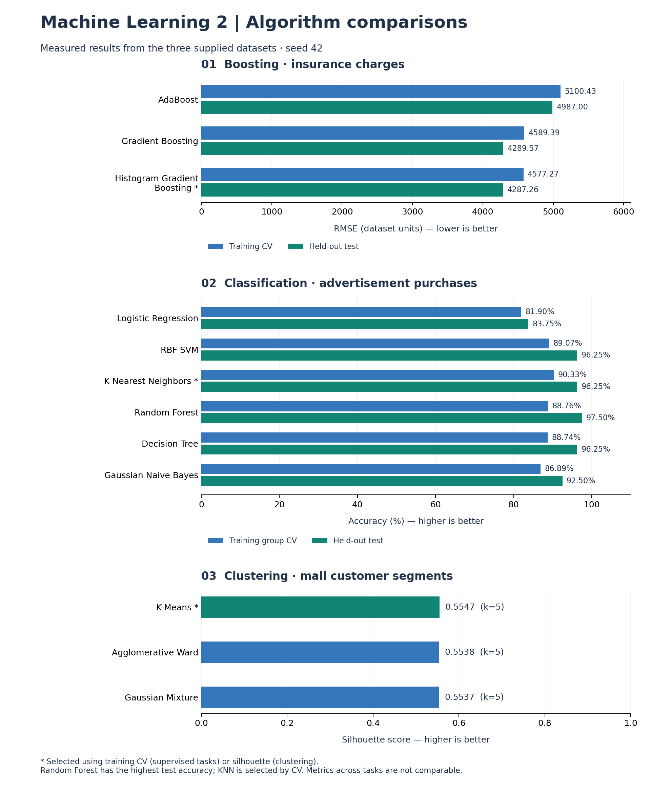

# Three dataset machine learning comparison

The uploaded datasets are used for separate tasks. Scores across tasks are not directly comparable.

| Task | Dataset | Target / features | Selection metric |
|---|---|---|---|
| Boosting regression | insurance_pre.csv | charges; age, sex, bmi, children, smoker | Lowest training 5-fold CV RMSE |
| Classification | Social_Network_Ads.csv | Purchased; Gender, Age, EstimatedSalary | Highest training 5-fold group CV accuracy |
| Clustering | Mall_Customers.csv | Annual Income and Spending Score, standardized | Highest silhouette, k from 2 through 8 |

## Results

- Boosting: Histogram Gradient Boosting selected by CV; test RMSE **4287.2643**, test R² **0.899973**.
- Classification: K Nearest Neighbors selected by CV accuracy **90.3262%**; test accuracy **96.25%**. Random Forest has the highest observed test accuracy, **97.5% (78/80)**, but is not selected using the test set.
- Clustering: K Means, **5 clusters**, silhouette **0.554657**. This is an internal clustering measure, not labelled accuracy.

All algorithms and exact results are in results/results.json and the three result CSVs. The website displays these saved outputs; training is performed in Python, not in the browser.

## Graphs



See the [comparison report](COMPARISON_REPORT.md#graphs-and-worked-examples) for explanations, actual-versus-predicted charges, a confusion matrix, and customer clusters. Regenerate the overview with `python ml/plot_comparisons.py` after training.

## Reproduce

Install the versions in requirements.txt, then from the repository root:

```sh
python ml/train_compare.py
```

Keep the script in `ml/`, the three original CSVs in `ml/data/` and an output directory `ml/results/`.

## Evaluation design

Insurance has 1338 input rows. One exact duplicate is removed before the 80/20 split, leaving 1069 train and 268 test rows. All five available predictors are used. Charges are evaluated in the dataset's original units; no currency is assumed.

Ads has 400 rows, with 320 training and 80 test rows. User ID is excluded. Identical Gender/Age/EstimatedSalary combinations are kept in the same group for the outer holdout and inner CV, preventing the same feature combination appearing on both sides. There are 379 such groups. All original rows remain in the data.

Preprocessing is fitted inside scikit-learn pipelines within each training fold. Numeric features are imputed and standardized; categorical features are imputed and one-hot encoded. The supplied files have no missing values. GridSearchCV selects hyperparameters on training data only. Fold score standard deviations are descriptive, not confidence intervals. Model family selection from the same CV results has selection bias; the reserved test gives a separate estimate. Only a single outer split is used, so small differences are not proof of general superiority.

Mall has 200 rows. CustomerID, Genre and Age are not used in clustering; this exercise specifically segments customers by income and spending. The two selected features are standardized. K Means, Ward agglomerative clustering and Gaussian mixtures each evaluate k=2..8 on the same feature space and all 200 points. Silhouette selects k and the algorithm on this same sample; results are exploratory and have no held-out generalization claim. Cluster IDs are arbitrary numbers.

## Saved evidence

- Dataset SHA-256 fingerprints and software versions: results.json.
- Exact train/test source CSV line numbers: insurance_split.csv and ads_split.csv.
- Held-out actual and predicted outputs: regression_predictions.csv and classification_predictions.csv.
- All 21 clustering candidates: cluster_all_candidates.csv.
- Selected cluster membership: mall_cluster_assignments.csv.
- Selected trained estimators: three joblib files. Load only model files from trusted sources; joblib uses Python pickle.
- Charts: insurance_predictions.png, ads_confusion_matrix.png and mall_clusters.png.
- Console execution evidence: training.log.

## References

- scikit-learn, leakage and pipelines: https://scikit-learn.org/stable/common_pitfalls.html
- scikit-learn, cross-validation: https://scikit-learn.org/stable/modules/cross_validation.html
- scikit-learn, silhouette score: https://scikit-learn.org/stable/modules/generated/sklearn.metrics.silhouette_score.html

These are educational comparisons, not deployed medical, financial or advertising decision systems.
